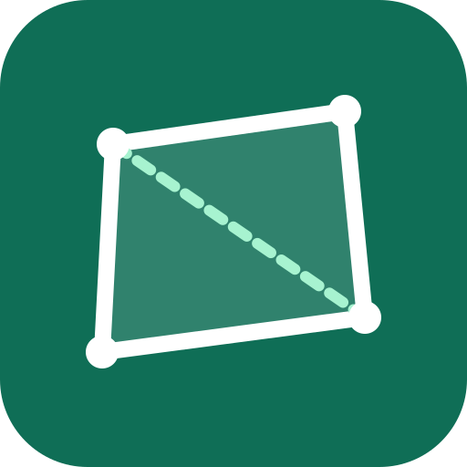

<div align="center">



# ভূমিমাপ (BhumiMap)

**বাংলাদেশি ২ডি ক্যাড (2D CAD), ২.৫ডি/৩ডি স্থাপত্য স্টুডিও এবং BNBC 2020 স্ট্রাকচারাল ফিজিক্স ইঞ্জিন**

[English (README.md)](README.md) · **বাংলা**

[](https://aetheioai.github.io/BhumiMap/)
[](LICENSE)
[](https://react.dev/)
[](https://threejs.org/)
[](https://www.typescriptlang.org/)
[](#নিজের-কম্পিউটারে-চালানো-ও-অফলাইন-ব্যবহার)

</div>

---

**ভূমিমাপ (BhumiMap)** হলো সম্পূর্ণ অফলাইন, প্রাইভেসি-ফার্স্ট এবং ওপেন-সোর্স **বাংলাদেশি ভবন নকশা ও প্রি-ইঞ্জিনিয়ারিং স্টুডিও**। বাংলাদেশের আবাসন আইন, নির্মাণের বাস্তব রীতি এবং সিভিল ইঞ্জিনিয়ারিং মানদণ্ড মাথায় রেখে তৈরি এই অ্যাপে একসাথে থাকছে নির্ভুল **২ডি ফ্লোর-প্ল্যান ক্যাড (2D CAD)**, তাৎক্ষণিক **২.৫ডি ও ৩ডি ওয়েবজিএল মডেলিং**, **রাজউক (RAJUK) / ইমারত নির্মাণ বিধিমালা** অনুযায়ী সেটব্যাক ও MGC/FAR যাচাই, **BNBC 2020** স্ট্রাকচারাল ফিজিক্স এবং সম্পূর্ণ **বাংলাদেশি নির্মাণ সামগ্রীর হিসাব (BOQ)**।

আপনি যদি নিজের ৩ কাঠা জমিতে বাড়ি বা গ্রামের পাকা বাড়ির নকশা দেখতে চান, কিংবা একজন সিভিল ইঞ্জিনিয়ার হিসেবে AutoCAD, ETABS ও CSI SAFE-এ যাওয়ার আগে দ্রুত স্ট্রাকচারাল গ্রিড, কলাম লোড, বাঁকা দেয়াল (Curved Wall) ও ফুটিং চাপ যাচাই করতে চান—দুই ক্ষেত্রেই ভূমিমাপ অত্যন্ত সহজ ও নির্ভুলভাবে কাজ করে।

---

## সাধারণ বাড়ির মালিক ও সিভিল ইঞ্জিনিয়ার — সবার জন্য

| ব্যবহারকারী | মোড | যা যা পাবেন |
| --- | --- | --- |
| **বাড়ির মালিক ও পরিবার** | **Homeowner মোড** | সহজ **৬-ধাপের গাইডেড ওয়ার্কফ্লো** (*জমি ও আইন → স্ট্রাকচার → দেয়াল ও কার্ভ → দরজা-সিঁড়ি → আসবাব ও সাইট → ফিজিক্স ও বাজেট*), ১২টি যাচাইকৃত বাংলাদেশি রেডি টেমপ্লেট, সহজ ভাষায় নিরাপত্তা পরামর্শ এবং টাকায় (লক্ষ টাকা) প্রাথমিক খরচ। |
| **সিভিল ইঞ্জিনিয়ার ও আর্কিটেক্ট** | **Engineer মোড** | AutoCAD মানের স্ট্রাকচারাল গ্রিডলাইন (`A–1`), নির্ভুল `ft'-in"` ক্যাড রুলার, BNBC 2020 ভূমিকম্প জোন `১–৪` ও মাটির শ্রেণি `SA–SE`, ETABS ঘরানার **RCC ফ্রেম এক্স-রে**, D/C স্ট্রেস হিটম্যাপ, CSI SAFE ফুটিং চাপ যাচাই এবং রাজউক কমপ্লায়েন্স শিট। |

---

## মূল বৈশিষ্ট্যসমূহ

### ১. বাংলাদেশের ভূমি পরিমাপ ও রাজউক (RAJUK) বিধিমালা
- **দেশীয় ভূমি একক**: **কাঠা**, **শতক (শতাংশ)**, **ফুট-ইঞ্চি (`ft'-in"`)** অথবা **মিটার (`m`)** এককে সরাসরি প্লট তৈরি করা যায়।
- **পাশের ভবনের সাথে বাধ্যতামূলক সেটব্যাক**: উত্তর, দক্ষিণ, পূর্ব বা পশ্চিম—যেকোনো দিকের রাস্তার সাপেক্ষে সামনে, পেছনে ও দুই পাশের আইনি ফাঁকা জায়গা (*Setback*) তাৎক্ষণিক যাচাই করে, যাতে পাশের বাড়ির সাথে দেয়াল বা ছাদ সংঘর্ষ না করে। শহর (রাজউক/সিটি কর্পোরেশন), মফস্বল (পৌরসভা) ও গ্রামীণ বাড়ির জন্য আলাদা বাস্তবসম্মত নিয়ম সমর্থন করে।
- **সরাসরি MGC ও FAR হিসাব**: প্লটের সর্বোচ্চ ভূমি আচ্ছাদন (**MGC %**) এবং ফ্লোর এরিয়া রেশিও (**FAR**) সীমা অতিক্রম করলে তাৎক্ষণিক সতর্কবার্তা এবং ২ডি ও ৩ডি উভয় ভিউতে সেটব্যাক বর্ডার দেখার সুবিধা।

### ২. প্রফেশনাল ২ডি ক্যাড ড্রাফটিং ও বাঁকা দেয়াল (Curved Walls)
- **সোজা ও বাঁকা (Arc) দেয়াল**: ১০ ইঞ্চি বাহিরের ইটের দেয়াল, ৫ ইঞ্চি পার্টিশন, এক্সপোজড লাল ইট, ফেয়ার-ফেসড কংক্রিট, হলো ব্লক, আরসিসি শিয়ার ওয়াল বা জালি ব্রিক আঁকা যায়। যেকোনো দেয়ালের মাঝের নীল হ্যান্ডেল টেনে নিখুঁত **বাঁকা ফ্রন্ট ফ্যাসাড (Curved Wall)** তৈরি করা সম্ভব।
- **স্বয়ংক্রিয় জয়েন্ট ও রুম ডিটেকশন**: দেয়াল একে অপরকে ছেদ করলে স্বয়ংক্রিয়ভাবে ভাগ হয়ে নিখুঁত কর্নার মিটার জয়েন্ট তৈরি করে, কলামের সাথে দেয়াল নিখুঁতভাবে মিলে যায় এবং বদ্ধ ঘরগুলো স্বয়ংক্রিয়ভাবে মাপসহ শনাক্ত হয়।
- **প্রকৃত ছাদের কাটআউট (Slab Cutout)**: ডগ-লেগ সিঁড়ি, প্যাসেঞ্জার লিফট বা ডুপ্লেক্স ডাবল-হাইট ভয়েডের জন্য ছাদে আসল ফাঁকা কাটআউট তৈরি করা যায়, যা ৩ডি-তেও নিখুঁতভাবে দেখা যায়।
- **ভুলবশত নড়ে যাওয়া রোধে নির্ভুল কন্ট্রোল**: একবার ক্লিক করলে কেবল সিলেক্ট হয়—কোনো কিছু হুট করে সরে যায় না। কোনো এলিমেন্ট সরাতে হলে আগে সিলেক্ট করে `6 px` ডেডজোন পেরিয়ে টানতে হয় অথবা কীবোর্ডের তীর চিহ্ন (`১"` / `Shift + Arrow` `৬"`) ব্যবহার করা যায়। যেকোনো দেয়াল, কলাম বা সম্পূর্ণ লেয়ার (`L` চেপে) লক করে রাখা যায়।

### ৩. লাইভ ২.৫ডি অ্যাক্সোনোমেট্রিক ও ৩ডি ওয়েবজিএল স্টুডিও
- **স্ট্রাকচারাল RCC এক্স-রে মোড (`X`)**: দেয়াল ও প্লাস্টার আড়াল করে সরাসরি আরসিসি কলাম, ড্রপ বিম, ছাদ, সিঁড়ির কাটআউট এবং মাটির নিচের ফুটিং কাঠামো পরীক্ষা করা যায়।
- **হার্ডওয়্যার GPU সেকশন কাটঅ্যাওয়ে**: দেয়াল বা আসবাবের আকৃতি বিকৃত না করে যেকোনো উচ্চতায় নিখুঁতভাবে তলা কেটে ভেতরের প্ল্যান দেখা যায়।
- **ইন্টারেক্টিভ ৩ডি দরজা ও বাংলাদেশি স্থাপত্য উপাদান**: ৩ডি ভিউতে দরজায় ক্লিক করলে দরজা খোলে ও বন্ধ হয়। এছাড়াও থাকছে বৃষ্টির **ছাজ্জা (Chajja)**, জানালার **এমএস নিরাপত্তা গ্রিল**, ছাদযুক্ত **বারান্দা**, ছাদের ওপর দরজাসহ **চিলেকোঠা (Chilerkotha)** ও গাজী পানির ট্যাংক।
- **৪৪টি নিখুঁত বাংলাদেশি ৩ডি মডেল**: অপ্রয়োজনীয় বা পশ্চিমা উপাদান বাদ দিয়ে বাস্তবসম্মত ৪৪টি প্রয়োজনীয় মডেল—ডগ-লেগ ও এল-টার্ন সিঁড়ি, লিফট কোর, কলাপসিবল গেট, সেগুন কাঠের সোফা ও ডিভান, ডাইনিং সেট, গ্যাসের চুলাসহ রান্নাঘর, বাথরুম, দোকানের রোলিং শাটার, গাড়ি ও সিএনজি, গ্রামীণ নলকূপ, সিঁড়িসহ পুকুরঘাট, নারিকেল ও আম গাছ।

### ৪. BNBC 2020 স্ট্রাকচারাল ফিজিক্স ও স্পেশাল ফিট যাচাই
- **কলাম লোড পাথ ও ফুটিং যাচাই**: ছাদ থেকে নিচতলা পর্যন্ত প্রতিটি কলামের ওপর আসা ডেড ও লাইভ লোড (`1.2D + 1.6L`), কলামের ধারাবাহিকতা, কংক্রিট গ্রেড (`3000 / 3500 / 4000 PSI`), ৫০০ডব্লিউ রডের সক্ষমতা এবং মাটির ভারবহন ক্ষমতা (`q_allow` kPa) অনুযায়ী ফুটিংয়ের মাপ হিসাব করে।
- **ভূমিকম্প ও বাতাসের চাপ (BNBC 2020)**: বাংলাদেশের ৪টি ভূমিকম্প জোন (**জোন ১ খুলনা**, **জোন ২ ঢাকা**, **জোন ৩ চট্টগ্রাম**, **জোন ৪ সিলেট**) ও মাটির শ্রেণি (`SA–SE`) অনুযায়ী বেস শিয়ার (`Base Shear`) ও স্টোরি ড্রিফট (`Δ/h`) যাচাই করে।
- **শূন্য-সংঘর্ষ স্পেশাল ফিট চেক**: আসবাব দেয়াল বা কলামের ভেতরে ঢুকে গেলে, দরজার পাল্লা খোলার পথে বাধা থাকলে বা সিঁড়ির ওপরের ছাদে কাটআউট না থাকলে তাৎক্ষণিক দেখিয়ে দেয়।

### ৫. বাংলাদেশি নির্মাণ সামগ্রীর হিসাব (BOQ) ও এক্সপোর্ট
- তাৎক্ষণিক **নির্মাণ সামগ্রীর তালিকা**: ১ম শ্রেণির **ইট (সংখ্যা)**, ৫০ কেজির **সিমেন্ট (বস্তা)**, **৫০০ডব্লিউ টিএমটি রড (টন ও কেজি)**, **সিলেট মোটা বালি (CFT)**, **লোকাল বালি (CFT)**, **পাথর/খোয়া (CFT)**, মোট আরসিসি কংক্রিট, ফ্লোর টাইলস, দেয়ালের রং, দরজা-জানালার সংখ্যা এবং **লক্ষ টাকায় (BDT Lakh)** আনুমানিক খরচ।
- এক ক্লিকে **BOQ CSV ফাইল**, ইঞ্জিনিয়ারিং ডিসক্লেইমার ও কাঠা/শতক মাপসহ **উচ্চমানের ব্লুপ্রিন্ট PNG**, এবং অফলাইন ব্যাকআপের জন্য **`.bhumimap.json`** এক্সপোর্ট করা যায়।

---

## ১২টি যাচাইকৃত বাংলাদেশি স্থাপত্য টেমপ্লেট

প্রতিটি টেমপ্লেট রাজউক সেটব্যাক, MGC, FAR, BNBC 2020 কলাম-বিম লোড, সিঁড়ির কাটআউট ও দরজার ক্লিয়ারেন্সে শতভাগ উত্তীর্ণ (`০ ত্রুটি / ০ সতর্কতা`):

| বিভাগ | টেমপ্লেট | জমির পরিমাণ | তলা | মূল বৈশিষ্ট্য |
| --- | --- | --- | --- | --- |
| **সিটি অ্যাপার্টমেন্ট** | ঢাকা ৩ কাঠা অ্যাপার্টমেন্ট | ৩.০ কাঠা | G+4 | নিচতলায় গাড়ি পার্কিং + প্রতি তলায় ৩ বেডের আদর্শ ফ্ল্যাট ও বারান্দা |
| **সিটি অ্যাপার্টমেন্ট** | সিটি ৫ কাঠা টুইন-ইউনিট | ৫.০ কাঠা | G+5 | প্রতি তলায় দুটি সমান ফ্ল্যাট, প্যাসেঞ্জার লিফট, সিঁড়ি ও পার্কিং |
| **সিটি অ্যাপার্টমেন্ট** | ২.৫ কাঠা ভাড়াটিয়া বাড়ি | ২.৫ কাঠা | G+3 | শহরের মাঝারি জমিতে সর্বোচ্চ বৈধ MGC ব্যবহার করে আধুনিক ভাড়া বাড়ি |
| **দোকান ও মিক্সড** | বাজার মিক্সড-ইউজ দোকান ও ফ্ল্যাট | ২.৩ কাঠা | G+3 | রাস্তামুখী রোলিং শাটারসহ দোকান (নিচতলা) + ওপরে আবাসিক ফ্ল্যাট |
| **দোকান ও মিক্সড** | কর্নার কার্ভড-ফ্যাসাড মিক্সড | ৩.১ কাঠা | G+4 | দৃষ্টিনন্দন **বাঁকা ফ্রন্ট ফ্যাসাড**, নিচতলা বাণিজ্যিক ও ওপরে ফ্ল্যাট |
| **ডুপ্লেক্স বাড়ি** | ৩ কাঠা আরবান ডুপ্লেক্স | ৩.০ কাঠা | G+1 | নিচে ড্রয়িং-ডাইনিং ও রান্নাঘর, ওপরে ফ্যামিলি লিভিং ও বেডরুম |
| **ডুপ্লেক্স বাড়ি** | ৪ কাঠা কার্ভড-ফ্যাসাড ডুপ্লেক্স | ৪.০ কাঠা | G+1 | আধুনিক **বাঁকা ড্রয়িং ফ্যাসাড**, প্রশস্ত টেরেস ও ইনডোর পার্কিং |
| **কম্প্যাক্ট শহর** | ২ কাঠা ফ্যামিলি হোম | ২.০ কাঠা | G+2 | ছোট শহুরে প্লটে আইনসম্মত সেটব্যাক রেখে উজ্জ্বল আলো-বাতাসের নকশা |
| **কম্প্যাক্ট শহর** | ১.৫ কাঠা মফস্বল স্টার্টার বাড়ি | ১.৫ কাঠা | G+1 | জেলা শহর ও পৌরসভার ছোট জমির জন্য সাশ্রয়ী ও কার্যকর ২ তলা বাড়ি |
| **গ্রামীণ বাড়ি** | গ্রামীণ পাকা বাড়ি | ৮.০ শতক | একতলা | গোল পিলার ও ছাদসহ প্রশস্ত বারান্দা, সামনের উঠান, নলকূপ ও পুকুরঘাট |
| **গ্রামীণ বাড়ি** | গ্রামীণ দোতলা বসতবাড়ি | ১০.০ শতক | G+1 | যৌথ পরিবারের জন্য খোলামেলা উঠান ও বারান্দাসহ দোতলা গ্রামের বাড়ি |
| **গ্রামীণ বাড়ি** | গ্রামীণ এল-শেপ (L-Plan) বাড়ি | ৮.৫ শতক | একতলা | আম ও নারিকেল গাছঘেরা উঠানকে কেন্দ্র করে ঐতিহ্যবাহী L-আকৃতির নকশা |

---

## কীবোর্ড ও মাউস শর্টকাট

| কাজ | শর্টকাট / নিয়ন্ত্রণ |
| --- | --- |
| **ড্রাফটিং টুলস** | `V` সিলেক্ট · `W` সোজা দেয়াল · `U` বাঁকা দেয়াল · `C` কলাম/পিলার · `G` রুম · `D` দরজা · `N` জানালা · `B` বিম · `S` স্ল্যাব · `K` স্ল্যাব কাটআউট · `M` মাপকাঠি · `A` ক্ষেত্রফল |
| **সরাসরি দৈর্ঘ্য টাইপ** | দেয়াল বা বিম আঁকার সময় সরাসরি মাপ টাইপ করে (যেমন `12.5` বা `12'6`) `Enter` চাপুন |
| **সোজা কোণ লক (Ortho)** | আঁকার সময় `Shift` চেপে ধরলে `0° / 45° / 90°` কোণে লক হবে |
| **মুক্তভাবে বসানো** | আসবাব টানার সময় `Alt` চেপে ধরলে দেয়ালে অটো-স্ন্যাপ সাময়িকভাবে বন্ধ থাকবে |
| **সূক্ষ্ম সরানো (Nudge)** | সিলেক্ট করা বস্তু `Arrow` কী দিয়ে `১"` এবং `Shift + Arrow` দিয়ে `৬"` সরানো যায় |
| **লক / ঘোরানো / মুছা** | `L` লক/আনলক · `R` ৯০° ঘোরানো · `Delete` / `Backspace` মুছে ফেলা |
| **ভিউ ও ওভারলে** | `1` ২ডি প্ল্যান · `2` স্প্লিট · `3` ২.৫ডি · `4` ৩ডি · `X` স্ট্রাকচারাল এক্স-রে · `H` স্ট্রেস হিটম্যাপ · `F` স্ক্রিনে ফিট |
| **প্যান ও জুম** | `Space + Drag` বা মাউসের মাঝের বাটনে প্যান · স্ক্রল হুইলে কার্সার-কেন্দ্রিক জুম |
| **৩ডি দরজা খোলা/বন্ধ** | ৩ডি ভিউতে সিলেক্ট করা দরজায় ক্লিক (অথবা যেকোনো দরজায় ডাবল-ক্লিক) করুন |
| **আনডু / রিডু** | `Ctrl+Z` আনডু · `Ctrl+Shift+Z` / `Ctrl+Y` রিডু · `Esc` বাতিল |

---

## নিজের কম্পিউটারে চালানো ও অফলাইন ব্যবহার

### প্রয়োজনীয় সফটওয়্যার
- **Node.js** `>= 20`
- **npm** `>= 10`

### ইনস্টলেশন ও ডেভেলপমেন্ট সার্ভার

```bash
# রিপোজিটরি ক্লোন করুন
git clone https://github.com/aetheioai/BhumiMap.git
cd BhumiMap

# ডিপেন্ডেন্সি ইনস্টল করুন
npm install

# ডেভেলপমেন্ট সার্ভার চালু করুন (http://localhost:3000)
npm run dev
```

### টাইপ যাচাই ও প্রোডাকশন বিল্ড

```bash
# TypeScript টাইপ যাচাই
npm run lint

# অফলাইন-রেডি প্রোডাকশন বিল্ড তৈরি (dist/)
npm run build

# বিল্ড প্রিভিউ দেখুন
npm run preview
```

ভূমিমাপ একটি ইনস্টলযোগ্য **প্রগ্রেসিভ ওয়েব অ্যাপ (PWA)**। ব্রাউজারে একবার লোড করার পর ইনস্টল করে নিলে ইন্টারনেট ছাড়াই সম্পূর্ণ অফলাইনে ব্যবহার করা যাবে।

---

## ইঞ্জিনিয়ারিং সতর্কতা (Disclaimer)

> **প্রাথমিক নকশা ও প্রি-ইঞ্জিনিয়ারিং টুল:** ভূমিমাপে প্রদর্শিত স্থাপত্য নকশা, রাজউক সেটব্যাক/MGC/FAR সূচক, BNBC 2020 প্রাথমিক লোড বিশ্লেষণ এবং নির্মাণ সামগ্রীর হিসাব কেবল পরিকল্পনা ও প্রোটোটাইপিংয়ের জন্য। চূড়ান্ত নির্মাণ নকশা, রডের ডিটেইলিং, সয়েল টেস্ট ভিত্তিক ফাউন্ডেশন ডিজাইন এবং অনুমোদনের জন্য **অবশ্যই** একজন লাইসেন্সপ্রাপ্ত সিভিল/স্ট্রাকচারাল ইঞ্জিনিয়ারের মাধ্যমে BNBC 2020 ও স্থানীয় বিধিমালা অনুযায়ী যাচাই করে নিতে হবে।

---

## অবদান, গোপনীয়তা ও লাইসেন্স

- **অবদান রাখুন**: নতুন বাংলাদেশি টেমপ্লেট, বাগ ফিক্স বা ফিচার যোগ করতে পুল রিকোয়েস্ট স্বাগত। শুরু করার আগে [CONTRIBUTING.md](CONTRIBUTING.md) দেখুন।
- **গোপনীয়তা ও নিরাপত্তা**: শতভাগ ব্রাউজারে লোকালভাবে চলে—কোনো নকশা বা ব্যক্তিগত তথ্য সার্ভারে পাঠানো হয় না। বিস্তারিত [SECURITY.md](SECURITY.md)-এ দেখুন।
- **লাইসেন্স**: এই ওপেন-সোর্স প্রজেক্টটি [MIT License](LICENSE)-এর অধীনে উন্মুক্ত।
