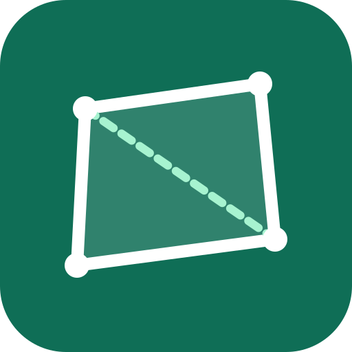

<div align="center">



# BhumiMap (ভূমিমাপ)

**Open-Source Bangladeshi 2D CAD, 2.5D/3D Architectural Studio & BNBC 2020 Structural Physics Engine**

**English** · [বাংলা (README.bn.md)](README.bn.md)

[](https://aetheioai.github.io/BhumiMap/)
[](LICENSE)
[](https://react.dev/)
[](https://threejs.org/)
[](https://www.typescriptlang.org/)
[](#run-locally--offline-pwa)

</div>

---

**BhumiMap** is a local-first, privacy-respecting architectural design and structural pre-engineering studio built specifically for **Bangladesh**. It unites precision **2D CAD floor-plan drafting**, live **2.5D/3D WebGL architectural modeling**, **RAJUK / Imarat Nirman Bidhimala** setback & MGC/FAR checks, **BNBC 2020** structural analysis, and a complete **Bangladesh construction BOQ (Bill of Quantities)** in a single browser workspace with zero cloud lock-in.

Whether you are a homeowner planning a 3 Katha Dhaka apartment or a Grameen homestead (*Bari*), or a civil engineer prototyping structural grids, column load paths, curved facades, and footing pressures before moving to AutoCAD, ETABS, and CSI SAFE, BhumiMap is engineered to serve both workflows cleanly.

---

## Built for Both Homeowners & Civil Engineers

| Audience | Experience Mode | What You Get |
| --- | --- | --- |
| **Homeowners & Families** | **Homeowner Mode** | A guided **6-step workflow** (*Land & Law → Structure → Walls & Curves → Doors & Stairs → Essentials → Physics & BOQ*), 12 verified Bangladeshi starter plans, plain-language safety alerts, and instant BDT Lakh estimates. |
| **Civil Engineers & Architects** | **Engineer Mode** | AutoCAD-style structural gridlines (`A–1`), exact `ft'-in"` CAD rulers, BNBC 2020 Seismic Zones `1–4` & Soil Site Classes `SA–SE`, ETABS-inspired **RCC Frame X-Ray**, D/C utilization heatmaps, CSI SAFE footing bearing pressure checks, and RAJUK compliance sheets. |

---

## Key Capabilities

### 1. Authentic Bangladesh Land Law & RAJUK Compliance
- **Bangladeshi Land Units**: Define plots natively in **Katha (কাঠা)**, **Shotok / Decimal (শতক)**, **Feet & Inches (`ft'-in"`)**, or **Meters (`m`)**.
- **Mandatory Neighbor & Road Setbacks**: Live verification across all four road orientations (**North / South / East / West**) for Urban (Dhaka / RAJUK), Semi-Urban (Paurashava), and Village (*Grameen*) plots so neighboring buildings maintain legal air, light, and structural clearance.
- **Live MGC & FAR Envelope**: Real-time **Maximum Ground Coverage (MGC %)** and **Floor Area Ratio (FAR)** checks with toggleable 2D and 3D legal setback wireframes.

### 2. Precision 2D CAD Drafting & Curved Architecture
- **Straight & Curved Arc Walls**: Draw 10" exterior brick walls, 5" partition walls, exposed red brick, fair-faced concrete, hollow blocks, RCC shear walls, or *Jala* brick screens, and smoothly bend any wall into a true **curved architectural facade** with live midpoint arc handles.
- **Automatic CAD Joinery & Room Detection**: Intersecting walls split cleanly on placement, wall corners miter seamlessly without notches, columns clip intersecting masonry cleanly, and enclosed room polygons auto-detect with live dimensions.
- **True Slab Cutouts**: Carve real rectangular cutouts inside floor slabs for dog-leg staircases, passenger lift shafts, and duplex double-height voids.
- **Select-First Precision Controls**: Clicking an element strictly selects it without accidental nudging. Moving requires dragging past a `6 px` deadzone, using the dedicated center handle, or keyboard arrow nudging (`1"` / `Shift + Arrow` `6"`). Lock individual elements (`L`) or entire structural layers (*Columns, Walls, Slabs, Beams*).

### 3. Live 2.5D Axonometric & 3D WebGL Studio
- **Structural RCC Frame X-Ray (`X`)**: Strip away finishes and masonry to inspect pure RCC columns, drop beams, slabs, stair cutouts, and isolated pad footings directly in 3D.
- **True GPU Section Cutaway**: Slice multi-story buildings cleanly at any elevation using hardware clipping planes without distorting or squashing wall geometry.
- **Interactive 3D Doors & Authentic Details**: Click hinged or sliding doors in 3D to swing them open or closed; toggle monsoon rain *Chajja* sunshades, MS security grills, roofed *Baranda* verandas, rooftop *Chilerkotha* stairheads, and overhead Gazi water tanks.
- **44 Dedicated Bangladeshi 3D Models**: Curated, strictly functional catalog (dog-leg & L-turn staircases, lift cores, collapsible MS gates, *Segun* sofas & *Diwans*, dining sets, closed gas kitchens, wet-zone baths, *Dokan* rolling shutters, stilt-parking cars & CNG, *Nolkup* tube-wells, recessed *Pukur* ponds with stepped concrete ghats, and native palms/mango trees) rendered via a single shared zero-leak offscreen thumbnailer.

### 4. BNBC 2020 Structural Physics & Spatial Fit Engine
- **Top-Down Column Tributary Load Path**: Tracks cumulative axial loads (`1.2D + 1.6L`) from roof to ground, checking vertical column continuity, slenderness, concrete grade (`3000 / 3500 / 4000 PSI`), and 500W TMT steel capacity.
- **Beams, Slabs & Footings**: Checks beam flexure (`Mu / φMn`), `L/d` deflection ratios, two-way slab thickness, isolated pad footing sizing, and allowable soil bearing pressure (`q_allow` in kPa).
- **Seismic & Wind Lateral Checks**: Evaluates BNBC 2020 equivalent static base shear and story drift ratio (`Δ/h`) across **Zone 1 (Khulna)**, **Zone 2 (Dhaka)**, **Zone 3 (Chattogram)**, and **Zone 4 (Sylhet)** with Soil Classes `SA`–`SE`.
- **Zero-Overlap Spatial Fit Physics**: Separating Axis Theorem (SAT) collision checks catch furniture clipping walls or columns, blocked door swing arcs, and staircases missing upper-slab cutouts.

### 5. Bangladesh Civil BOQ & Blueprint Export
- Instant **Bill of Quantities (BOQ)** tailored to local construction markets: **1st-class bricks (pcs)**, **50 kg cement bags**, **500W TMT steel rod (tons & kg)**, **Sylhet coarse sand (CFT)**, **local filling/plaster sand (CFT)**, **stone chips / Khoa (CFT)**, **RCC concrete volume**, **floor tiles**, **paint area**, **door/window schedule**, and **estimated cost in BDT Lakhs**.
- One-click export to **BOQ CSV**, **High-Resolution Blueprint PNG** (stamped with land area in sq ft / Katha / Shotok and a BNBC civil engineering disclaimer), and portable **`.bhumimap.json`** project files.

---

## 12 Architect-Verified Bangladeshi Templates

Every starter template is audited against all RAJUK setbacks, MGC/FAR limits, BNBC 2020 load paths, stair cutouts, and furniture clearances (`0 critical issues / 0 warnings`):

| Category | Template | Land Plot | Floors | Architectural Highlights |
| --- | --- | --- | --- | --- |
| **City Apartments** | Dhaka 3 Katha Apartment | 3.0 Katha | G+4 | Ground stilt car parking + 3-bed typical flat with drawing/dining & balconies |
| **City Apartments** | City 5 Katha Twin-Unit | 5.0 Katha | G+5 | Dual symmetrical apartments per floor, lift core, dog-leg stair & stilt parking |
| **City Apartments** | 2.5 Katha Urban Rental Bari | 2.5 Katha | G+3 | High-efficiency rental flat layout maximizing legal MGC |
| **Shop & Mixed** | Bazar Mixed-Use Shop & Flats | 2.3 Katha | G+3 | Road-facing *Dokan* rolling shutters on Ground + residential apartments above |
| **Shop & Mixed** | Corner Curved-Facade Mixed | 3.1 Katha | G+4 | Smooth **curved architectural corner facade**, commercial ground + flats |
| **Duplex Homes** | 3 Katha Urban Duplex | 3.0 Katha | G+1 | Formal drawing/dining below, family lounge & bedrooms above with stair cutout |
| **Duplex Homes** | 4 Katha Curved-Facade Duplex | 4.0 Katha | G+1 | Signature **curved living facade**, wide roofed terrace & indoor parking |
| **Compact Urban** | Compact 2 Katha Family Home | 2.0 Katha | G+2 | Tight urban 2 Katha footprint with smart daylight shafts & legal neighbor margins |
| **Compact Urban** | 1.5 Katha Semi-Urban Starter | 1.5 Katha | G+1 | Affordable starter home designed for Paurashava / district town plots |
| **Village Bari** | Grameen Paka Bari | 8.0 Shotok | Ground | Full RCC-roofed front *Baranda* on round columns, *Uthan*, *Nolkup* & *Pukur* ghat |
| **Village Bari** | Grameen 2-Story Homestead | 10.0 Shotok | G+1 | Multi-generational village homestead with courtyard & roofed verandas |
| **Village Bari** | Grameen L-Plan Courtyard Bari | 8.5 Shotok | Ground | Classic L-shaped village residence framing a shaded mango/palm courtyard |

---

## Precision Keyboard & Mouse Controls

| Action | Shortcut / Control |
| --- | --- |
| **Tools** | `V` Select · `W` Straight Wall · `U` Curved Wall · `C` Pillar · `G` Room · `D` Door · `N` Window · `B` Beam · `S` Slab · `K` Slab Cutout · `M` Ruler · `A` Area |
| **Direct Length Input** | While drawing a wall or beam, type exact feet/meters (e.g. `12.5` or `12'6`) and press `Enter` |
| **Ortho Lock** | Hold `Shift` while drafting to snap to `0° / 45° / 90°` angles |
| **Free Placement** | Hold `Alt` while dragging furniture to temporarily bypass automatic wall-snapping |
| **Precision Nudge** | `Arrow Keys` move selected item by `1"` · `Shift + Arrow` moves by `6"` |
| **Lock / Rotate / Delete** | `L` Lock/Unlock selected element · `R` Rotate 90° · `Delete` / `Backspace` Remove |
| **Viewports & Overlays** | `1` 2D Plan · `2` Split · `3` 2.5D · `4` 3D · `X` Structural RCC X-Ray · `H` Stress Heatmap · `F` Fit to View |
| **Pan & Zoom** | `Space + Drag` or Middle-Mouse Pan · Cursor-centered Scroll Wheel Zoom |
| **Interactive 3D Doors** | Click a selected door (or double-click any door) in 3D view to open/close it |
| **History** | `Ctrl+Z` Undo · `Ctrl+Shift+Z` / `Ctrl+Y` Redo · `Esc` Cancel / Clear Selection |

---

## Architecture Overview

```text
src/
├── App.tsx                         # Studio orchestration, 6-step workflow, undo/redo & shortcuts
├── types/
│   └── building.ts                 # Canonical CAD, curved wall, slab cutout, BNBC & RAJUK types
├── engine/
│   ├── geometryKernel.ts           # Curved wall math, corner mitering, auto wall split, room detection, SAT OBB & RAJUK rules
│   ├── physics.ts                  # BNBC 2020 load paths, ETABS/SAFE checks, spatial fit & Bangladesh BOQ
│   ├── threeBuilder.ts             # 3D mesh generator, curved extrusion, slab hole cutouts, X-Ray, GPU clipping & zero-leak disposal
│   ├── assetModels3D.ts            # 44 dedicated multi-part procedural 3D builders (zero fallback boxes)
│   ├── assets.ts                   # Curated 44-item Bangladeshi functional asset catalog
│   ├── templates.ts                # 12 architect-verified Bangladeshi building templates & custom plot generator
│   ├── textures3D.ts               # Procedural brick, concrete, plaster, tile, grass, asphalt & sky textures
│   ├── units.ts                    # Katha, Shotok, Bigha, ft'-in", metric & kN/kip converters
│   └── projectStorage.ts           # LocalStorage v4 persistence, JSON import/export & watermarked PNG export
└── components/
    ├── TopBar.tsx                  # Header, view switcher, 6-step guided rail, Homeowner/Engineer toggle & layer locks
    ├── Canvas2D.tsx                # Precision 2D CAD drafting canvas with gridlines A-1, curved handles & OSNAP
    ├── Viewport3D.tsx              # Hardware-accelerated Three.js 2.5D/3D viewport with interactive doors & GPU cutaway
    ├── BottomViewportBar.tsx       # Story selector, drafting dock, X-Ray, Setbacks, Stress & camera controls
    ├── LeftDock.tsx                # On-demand functional 3D catalog drawer
    ├── Asset3DPreviewGrid.tsx      # Single shared offscreen WebGL thumbnailer (zero context warnings)
    ├── RightInspector.tsx          # Element properties, curved wall bulge, RAJUK & BNBC 2020 engineering panel
    ├── LandSetupWizard.tsx         # Bangladeshi land plot wizard & 12-template gallery
    └── TakeoffExportModal.tsx      # Complete Bangladesh BOQ table, RAJUK/BNBC summary & CSV/PNG/JSON export
```

---

## Run Locally & Offline PWA

### Prerequisites
- **Node.js** `>= 20`
- **npm** `>= 10`

### Installation & Development

```bash
# Clone the repository
git clone https://github.com/aetheioai/BhumiMap.git
cd BhumiMap

# Install dependencies
npm install

# Start the development server at http://localhost:3000
npm run dev
```

### Type-Check & Production Build

```bash
# Run strict TypeScript type-checking
npm run lint

# Build offline-ready production bundle (dist/)
npm run build

# Preview production build locally
npm run preview
```

BhumiMap ships as an installable **Progressive Web App (PWA)**. Once opened in Chrome, Edge, or Safari, install it to run completely offline with all project files saved locally in your browser.

---

## Engineering Disclaimer

> **Conceptual Design & Pre-Engineering Tool:** BhumiMap provides architectural layouts, RAJUK setback/MGC/FAR indicators, preliminary BNBC 2020 structural checks, and material BOQ estimates for planning and prototyping. Final construction drawings, RCC reinforcement detailing, soil sub-surface investigations, and structural sign-off **must** be verified and approved by a licensed civil/structural engineer in accordance with BNBC 2020 and local municipal regulations.

---

## Contributing, Security & License

- **Contributing**: Pull requests, architectural templates, regional improvements, and bug reports are welcome! Please see [CONTRIBUTING.md](CONTRIBUTING.md).
- **Privacy & Security**: 100% client-side execution with zero telemetry, zero ads, and zero server uploads. See [SECURITY.md](SECURITY.md).
- **License**: Released under the [MIT License](LICENSE).
